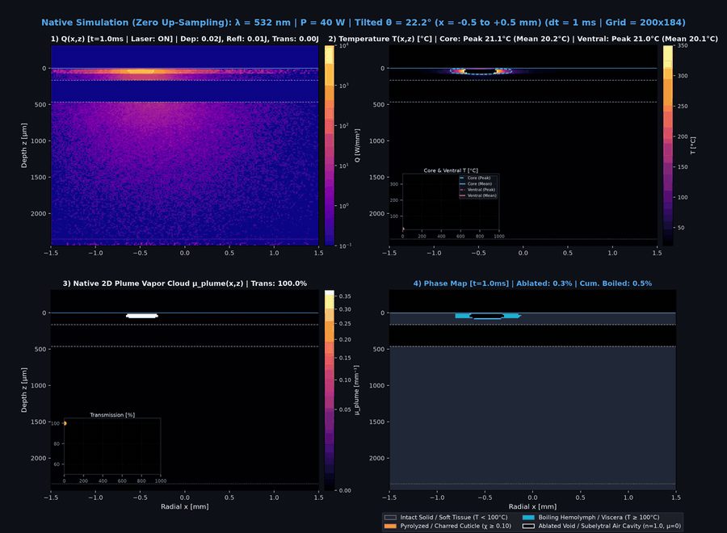
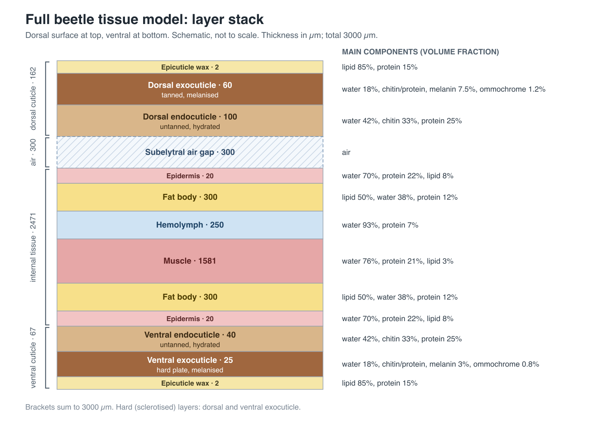
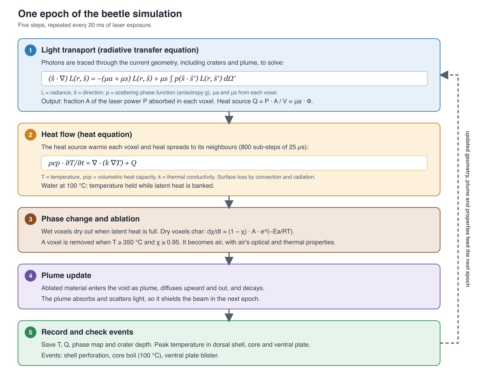
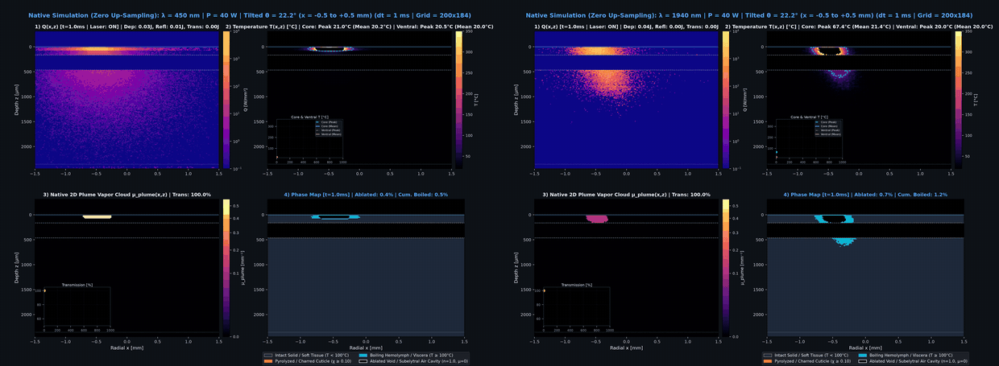
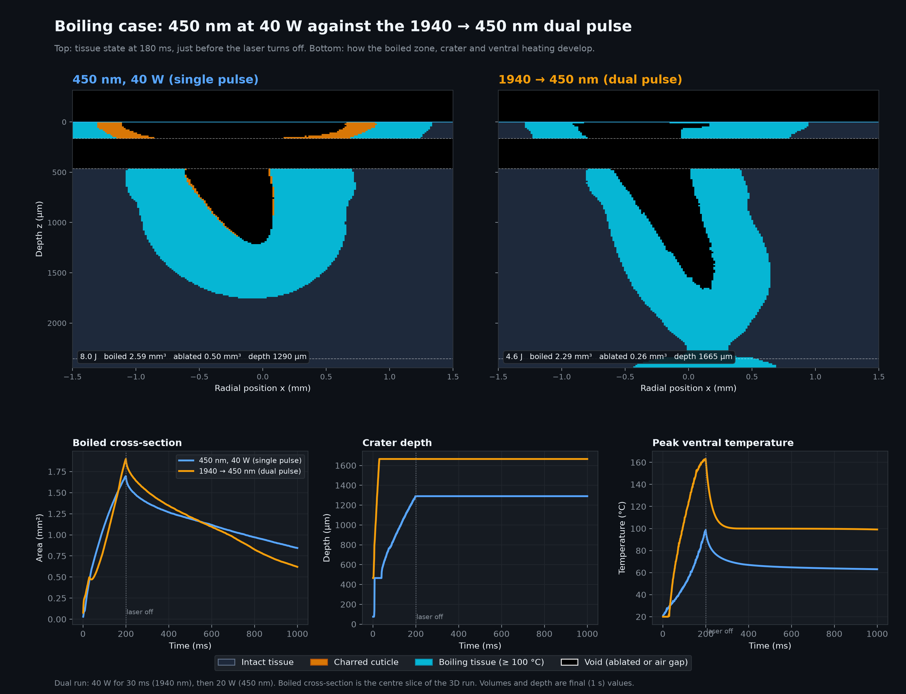
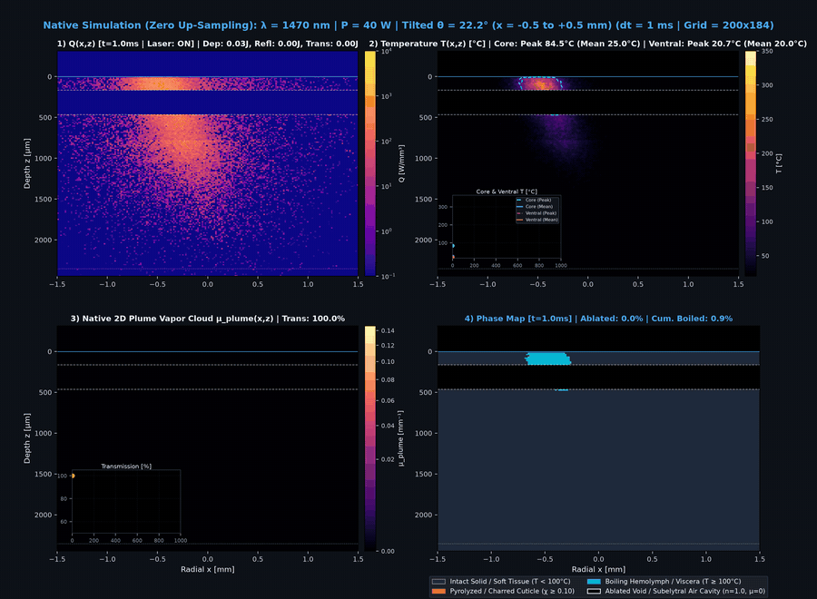
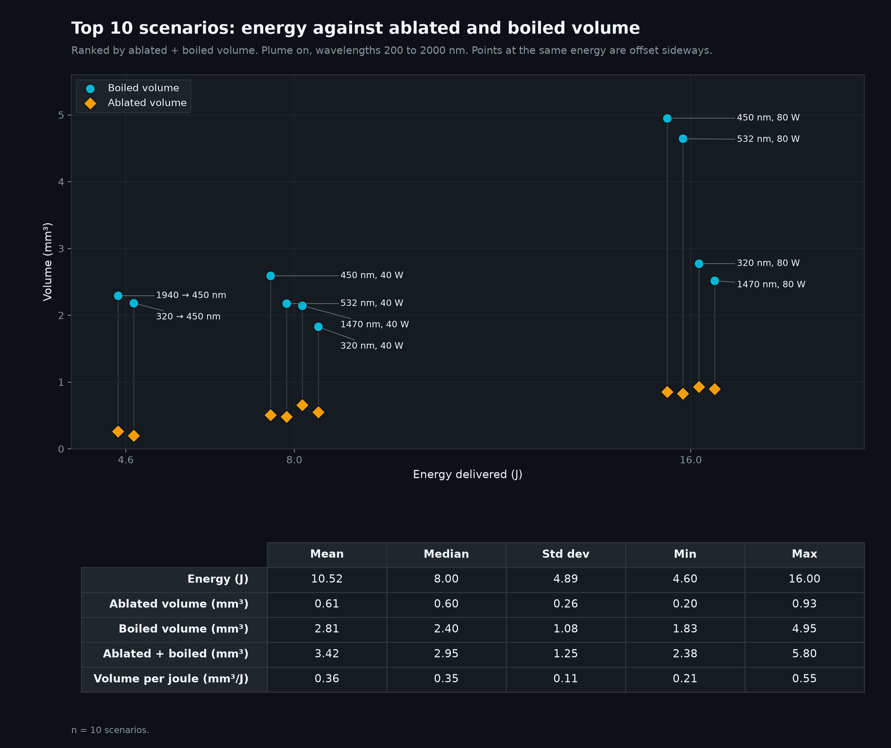
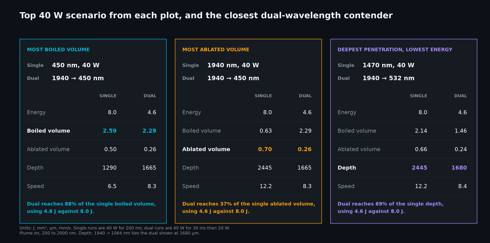
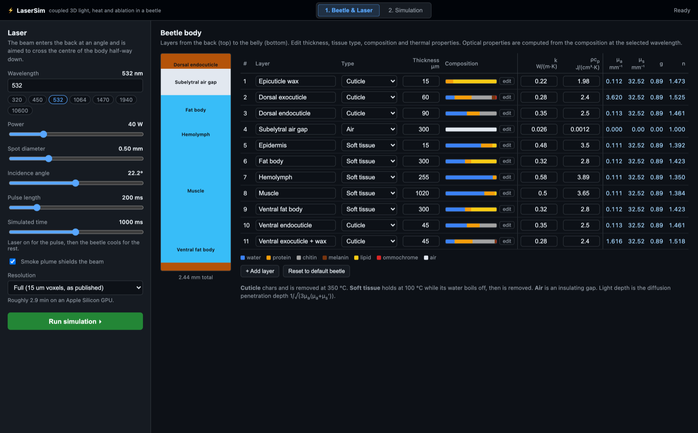
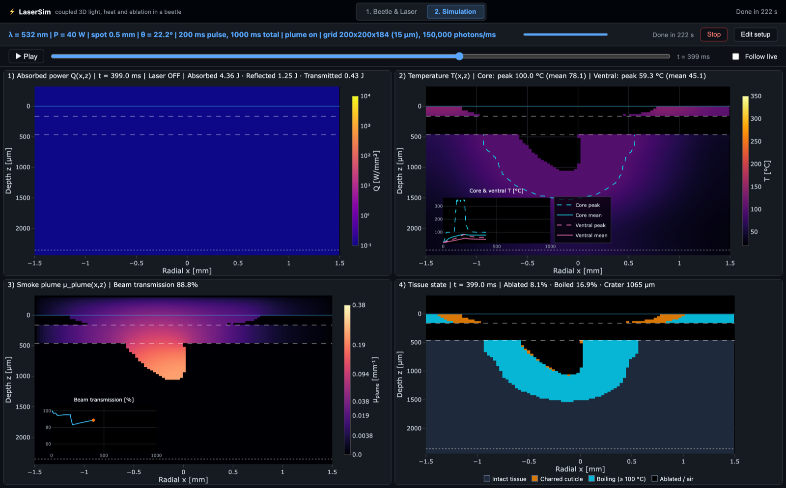

# Bug Defense: shooting a beetle with lasers (in simulation)

The code behind the *Bugs* post on [yudovsky.substack.com](https://yudovsky.substack.com/). It simulates a laser beam hitting an armored beetle in 3D: Monte Carlo light transport through a layered body, heat flow, boiling, charring and ablation, and a smoke plume that shields the beam. The geometry updates every millisecond, so the beam bores its way in.

This is a hobby project, not validated research. The light and heat solvers are checked against textbook benchmarks; the tissue coefficients, plume model and ablation thresholds are literature estimates.



*532 nm, 40 W, 0.5 mm spot, 22° incidence, 200 ms pulse then 800 ms of cooling. Top left: absorbed power. Top right: temperature. Bottom left: smoke plume and beam transmission. Bottom right: tissue state.*

## Setup

Requires macOS on Apple Silicon (the beetle runs use the Metal GPU engines) and Python 3.12.

```bash
python3 -m venv venv
source venv/bin/activate
pip install -r requirements.txt
python -m pytest tests/
```

`./run.sh setup` does the same. Every `./run.sh` command below uses `./venv` and creates it if it is missing.

## Reproducing the Bugs post

Each simulation run takes a few minutes on an M-series GPU and writes a ~165 MB array to `knowledge/beetle/raw_arrays/` plus an animation to `knowledge/beetle/plots/`. Both folders are git-ignored because together they run to several GB; the derived tables the post quotes are committed.

| Post item | Script | Command | Output |
|---|---|---|---|
| Half-width boiling animation (532 nm, 40 W, 22°) | [run_highres_knowledge_suite.py](knowledge/beetle/scripts/run_highres_knowledge_suite.py), rendered by [render_native_highres_animation.py](knowledge/beetle/scripts/render_native_highres_animation.py) | `./run.sh sim -w 532 -p 40` | `knowledge/beetle/raw_arrays/matrix_532nm_40w.npz`, `knowledge/beetle/plots/beetle_native_532nm_40w.gif` |
| Full-width ablation animation (1470 nm, 40 W, 22°) | same | `./run.sh sim -w 1470 -p 40` | `matrix_1470nm_40w.npz`, `beetle_native_1470nm_40w.gif` |
| Two-wavelength comparison (1940 → 450 nm vs 450 nm alone) | [run_dual_permutation_suite.py](knowledge/beetle/scripts/run_dual_permutation_suite.py), [render_450_vs_dual_boiling.py](knowledge/beetle/scripts/render_450_vs_dual_boiling.py) | `./run.sh sim -w 450 -p 40`, then `./run.sh dual 1940 450 40 20`, then `./run.sh figures` | `matrix_dual_1940nm_450nm.npz`, `plots/beetle_450nm_vs_dual_1940_450_boiling.png`; volumes and energies in [kpi_cache.json](knowledge/beetle/kpi_cache.json) |
| Minimum energy to penetrate (all wavelengths × 20/40/80 W, plus dual pulses) | [compute_min_energy.py](knowledge/beetle/scripts/compute_min_energy.py) | `./run.sh campaign`, `./run.sh permutations`, then `./run.sh figures` | [min_energy_to_penetrate.md](knowledge/beetle/min_energy_to_penetrate.md) and [.csv](knowledge/beetle/min_energy_to_penetrate.csv) |
| Epoch diagram parameters (1 ms step, 50 µs thermal sub-steps, 150,000 photons per step, 15 µm voxels, 100 °C boiling, 350 °C ablation, plume closure) | Constants at the top of [run_highres_knowledge_suite.py](knowledge/beetle/scripts/run_highres_knowledge_suite.py); char kinetics `CHAR_STATE` in [run_multispectral_matrix.py](simulation/run_multispectral_matrix.py) | none (read the constants) | Diagram: [beetle_simulation_flowchart.svg](knowledge/invertebrate_tissue_optics/beetle_simulation_flowchart.svg), hand-drawn |
| Tissue absorption and scattering spectra | [plot_beetle_chromophores.py](knowledge/invertebrate_tissue_optics/plot_beetle_chromophores.py) | `python knowledge/invertebrate_tissue_optics/plot_beetle_chromophores.py` | `beetle_absorption_chromophores.png`, `beetle_scattering_layers.png` in the same folder |
| Layer stack and thermal property tables | Hand-drawn; values from `BASE_LAYERS` in [tissue_stack.py](simulation/tissue_stack.py) and the layer table in [run_highres_knowledge_suite.py](knowledge/beetle/scripts/run_highres_knowledge_suite.py) | none | [beetle_layer_stack.svg](knowledge/invertebrate_tissue_optics/beetle_layer_stack.svg), [beetle_thermal_properties.svg](knowledge/invertebrate_tissue_optics/beetle_thermal_properties.svg) |
| Validation (MCML tables, Carslaw & Jaeger, Shimojo et al.) | [run_literature_benchmarks.py](knowledge/simulation_lit_comparison/code/run_literature_benchmarks.py) | `./run.sh benchmarks` | Report: [knowledge/simulation_lit_comparison/README.md](knowledge/simulation_lit_comparison/README.md); figures in `images/`, raw numbers in `raw_output/benchmark_results.json` |
| Bibliography: laser-on-insect studies | — | — | [knowledge/literature_review/README.md](knowledge/literature_review/README.md) |

Notes on matching the post's numbers:

- The energy split quoted for the two animations (for example 4.9 J absorbed and 1.6 J reflected at 532 nm) is drawn in the animation titles from a fixed table, `spectro_ref` in `render_native_highres_animation.py`, computed once for the intact beetle. It is not tallied from the run itself, where the crater changes what is absorbed.
- The dual-pulse energy (4.6 J) is hard-coded in `compute_suite_metrics.py`. It equals the schedule (40 W × 30 ms + 20 W × 170 ms), so the value is right.
- The validation report is `knowledge/simulation_lit_comparison/README.md`; `build_report.py` regenerates it.

## How the simulation works

### The beetle

The beetle is a stack of layers from the waxy outer shell through a 300 µm air gap, the fat body, hemolymph and muscle, down to the belly shell. Each layer is a mixture of chromophores (melanin, water, protein, chitin, lipid, ommochrome) that sets its absorption, scattering and refractive index at every wavelength, plus its conductivity, heat capacity and water content.




Layer compositions: `BASE_LAYERS` in [simulation/tissue_stack.py](simulation/tissue_stack.py). Optics model: the [insect_tissue_optics](knowledge/invertebrate_tissue_optics/insect_tissue_optics) package. Background and sources: [BEETLE_TISSUE_MODEL.md](knowledge/invertebrate_tissue_optics/BEETLE_TISSUE_MODEL.md).

### One time step

Every 1 ms step repeats the same loop:

1. **Light transport.** 150,000 photon packets are traced through the current geometry with a voxel Monte Carlo solver (based on MCML), giving the absorbed power in every voxel.
2. **Heat flow.** The heat equation is stepped forward with that source in 20 sub-steps of 50 µs. Water holds at 100 °C while it absorbs latent heat.
3. **Phase change and ablation.** Dried tissue chars (Arrhenius kinetics). A voxel above 350 °C, or fully charred, is removed and becomes air.
4. **Plume.** Ablated material enters the cavity as smoke and diffuses. It absorbs and scatters the beam on the next step.
5. **Record.** Temperatures, tissue state, crater depth and beam transmission are saved.



The flowchart's step size and sub-step labels are from an earlier configuration; the numbers above are the ones the runs use.

The engine is [simulation/coupled_ablation.py](simulation/coupled_ablation.py), built on [voxel_mc_3d.py](simulation/voxel_mc_3d.py) (light), [voxel_thermal_3d.py](simulation/voxel_thermal_3d.py) (heat) and [plume.py](simulation/plume.py) (smoke), with Metal GPU versions in the `*_metal.py` files.

## Results beyond the animations

A short 1940 nm pulse drills the shell, then 450 nm boils the inside: 88% of the single-pulse boiled volume for 58% of the energy.



*Left: 450 nm at 40 W for 200 ms. Right: 1940 nm at 40 W for 30 ms, then 450 nm at 20 W. The right-hand title shows only the first wavelength.*



Full-width ablation at 1470 nm, 40 W:



Every run is scored on boiled volume, ablated volume, depth and energy:





## Other tools in this repo

These are not part of the post.

### LaserSim desktop app

`./run.sh` with no arguments opens LaserSim, an interactive front end to the same 3D engine. `./run.sh ui --server-only` serves it at http://127.0.0.1:5050/ for a browser.

**Page 1, Beetle & Laser.** Set the laser (wavelength, power, spot size, incidence angle, pulse length, simulated time, plume on or off, grid resolution) and edit the beetle's layers: thickness, tissue type, chromophore composition, conductivity and heat capacity. Absorption, scattering, anisotropy, refractive index and light penetration depth update live for the chosen wavelength.



**Page 2, Simulation.** Runs the simulation and animates it in the same four panels as the post: absorbed power, temperature with core and ventral traces, smoke plume with beam transmission, and tissue state. Frames stream in live; afterwards you can play or scrub. The defaults reproduce the 532 nm, 40 W run above. Unlike the post's animations, the energy totals in the panel titles are tallied from the run itself.



A full-resolution run (15 µm voxels) takes about 4 minutes; the 30 µm preview takes under a minute. Code: [app.py](app.py) (native window), [server.py](server.py) (Flask backend), [simulation/beetle_sim.py](simulation/beetle_sim.py) (simulation driver), [templates/index.html](templates/index.html) (pages).

### Other runs in the campaign

The campaign also covers runs the post doesn't discuss: 10,600 nm (CO₂) at all three powers, no-plume controls at 40 W for every wavelength, the full 3 × 3 dual-pulse matrix (cutters 10,600, 1940 and 320 nm; heaters 532, 1064 and 450 nm), and a burst-mode versus CW comparison at 320 nm. Their scores are in [kpi_cache.json](knowledge/beetle/kpi_cache.json) and [min_energy_to_penetrate.md](knowledge/beetle/min_energy_to_penetrate.md); `./run.sh figures` also regenerates a full campaign report at `knowledge/beetle/README.md`.

## Running everything

```bash
./run.sh                          # open the LaserSim desktop app
./run.sh setup                    # create ./venv and install requirements
./run.sh test                     # unit tests
./run.sh sim                      # 532 nm at 40 W
./run.sh sim -w 532 1470 -p 40 80 # any wavelengths and powers
./run.sh dual 1940 450 40 20      # dual pulse: drill at 1940 nm, then heat at 450 nm
./run.sh campaign                 # all 21 single-wavelength runs plus controls
./run.sh permutations             # dual-pulse permutations
./run.sh figures                  # rescore runs, redraw figures, minimum-energy table
./run.sh gifs                     # re-render the animations from saved runs
./run.sh benchmarks               # verification and validation benchmarks
```

## Repository layout

| Path | What it holds |
|---|---|
| [simulation/](simulation) | The engine: Monte Carlo light transport, heat flow, ablation, plume, tissue optics, Metal GPU kernels, and the app's simulation driver |
| [knowledge/beetle/](knowledge/beetle) | Beetle runners, metrics, plotting scripts, the KPI cache and the minimum-energy table |
| [knowledge/invertebrate_tissue_optics/](knowledge/invertebrate_tissue_optics) | Tissue optics package, beetle model notes and figures |
| [knowledge/simulation_lit_comparison/](knowledge/simulation_lit_comparison) | Verification and validation benchmarks and their report |
| [knowledge/literature_review/](knowledge/literature_review) | Laser-on-insect studies: catalogue and open-access PDFs |
| [app.py](app.py), [server.py](server.py), [templates/](templates) | LaserSim desktop app |
| [docs/images/](docs/images) | Animations and screenshots used in this README |
| [tests/](tests) | Unit tests for the solvers, plume, tissue optics and the app's API |

## Known issues

- Four plume tests in `tests/test_plume.py` fail: the plume model changed after the tests were written.
- Heat conduction at these time and length scales ignores explosive boiling and material ejection, and the plume's optical coefficients were tuned, not measured.
