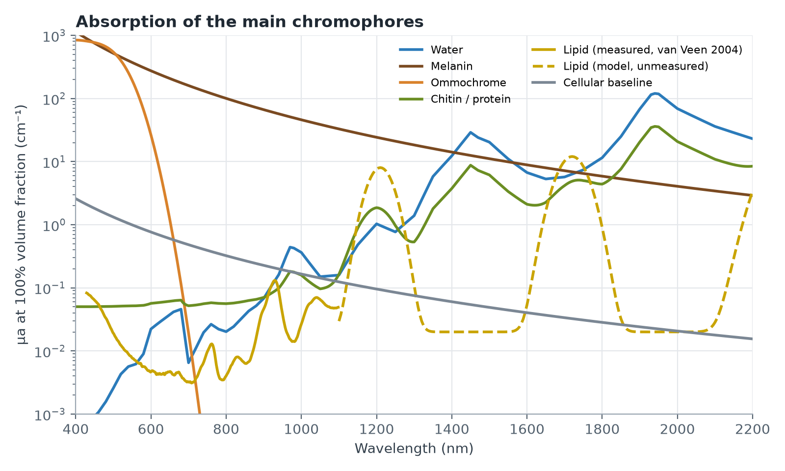
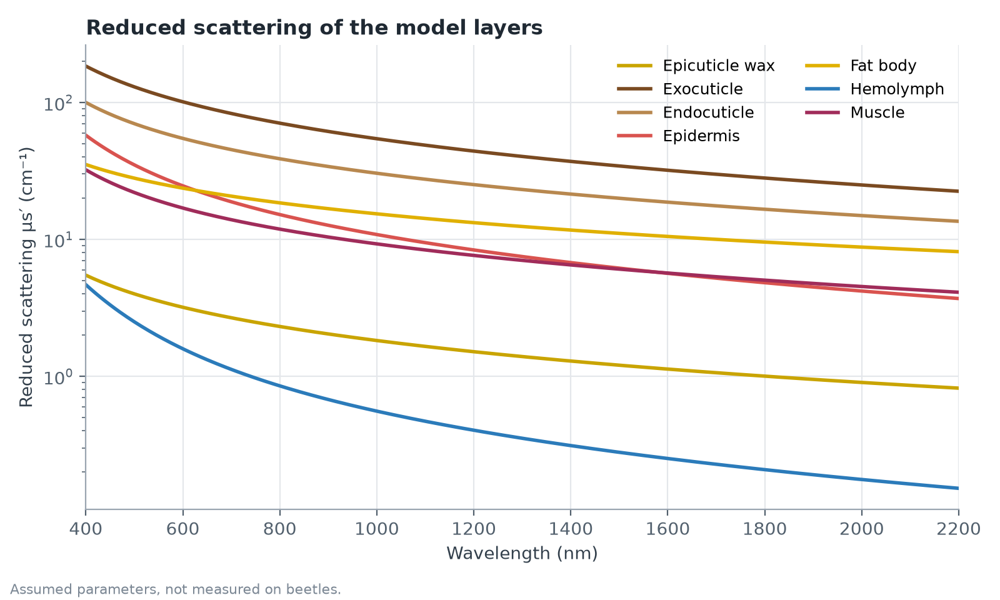

# Beetle Tissue Model

Written for: the project team (physics/simulation readers who know MCML and bioheat).

Summary of how adult beetle tissue is represented in `insect_tissue_optics/` and consumed by `simulation/tissue_stack.py`. Values below were read from the code and re-evaluated on 2026-10-18.

## 1. Model type

A 1-D planar multilayer closure. Each layer has a thickness, a volume-fraction composition, and a scattering parameterisation. The package supplies `n, μa, μs, g` per wavelength and does not solve transport. MCML or the voxel MC does that.

```
μa(λ)  = Σ fᵢ μa,ᵢ(λ) + 1.321·(λ/500)^-3      (additive over components + cellular baseline, cm⁻¹)
n(λ)   = Σ fᵢ nᵢ(λ)                            (linear volume mixing)
μs'(λ) = a'·[ f_ray (λ/500)^-4 + (1-f_ray)(λ/500)^-b_mie ]
g(λ)   = g500 · (500/λ)^0.2   for λ>500, clipped to [0, 0.99]
μs     = μs' / (1-g)
```

Composition fractions must sum to 1. Scattering is set per layer by hand (`a'`, `f_ray`, `b_mie`, `g500`), not derived from composition.

## 2. Chromophore basis (beetle-relevant)

| Component | Model | Confidence |
|---|---|---|
| Water | Pope & Fry (VIS), Hale & Querry (NIR/SWIR); log-log interpolation, strictly 200–12000 nm | High |
| Eumelanin | 519·(λ/500)^-3.5 cm⁻¹ at unit fraction. The "fraction" is a melanosome-equivalent, fitted to reflectance, not a literal volume | Medium |
| Ommochrome | Band near 440 nm, peak 600 cm⁻¹ at unit fraction. Scale is a free parameter | Low–medium |
| Chitin / protein | Index ≈1.555 / 1.55. Visible-transparent, with SWIR CH-overtone baselines | Indices high, μa baselines low |
| Lipid | n≈1.46, with 1210 and 1720 nm CH₂ bands | Medium |
| Hemoglobin / hemocyanin | **Absent** in insects. Insects have an open hemolymph system with tracheal gas exchange | n/a |

### Absorption spectra



Each curve is the pure component at 100% volume fraction. A layer's μa is the fraction-weighted sum of these plus the cellular baseline. Melanin and ommochrome dominate below about 600 nm. From about 1200 nm on, water and the chitin/protein overtones take over, and lipid adds bands at 1210 and 1720 nm. Pure melanin is still comparable to water around 1500–1700 nm. In the layers it matters far less than water there, because melanin is only 7.5% of the exocuticle and water is 18–93% of every layer, so pigmentation has little effect in the SWIR. The solid lipid curve is measured porcine fat (van Veen et al. 2004, [OMLC](https://omlc.org/spectra/fat/)), which covers only 431–1098 nm and shows the 930 nm band. The dashed part is the model's own approximation (three Gaussians on a flat 0.02 cm⁻¹ floor), which has no measured basis. The simulation still uses that approximation, not the measured curve. Plot script: [plot_beetle_chromophores.py](plot_beetle_chromophores.py).

### Scattering spectra



Scattering is not built from chromophores. It is set per layer, so this plot shows μs′ for each layer type of the dorsal stack. The exocuticle scatters most (about 100 cm⁻¹ at 600 nm) and hemolymph least. All these parameters are assumed, not measured on beetles.

## 3. Layer stacks

**Dorsal (`beetle_elytron`)**, top to bottom, in air above and n=1.40 tissue below:

| Layer | Thick. (µm) | Composition | μs' @500 (cm⁻¹) | g500 |
|---|---|---|---|---|
| Epicuticle wax | 2 | lipid 0.85, protein 0.15 | 4 | 0.80 |
| Exocuticle (tanned, melanised) | 60 | water 0.18, chitin/protein ≈ 55/45 of the solids, melanin 0.075, ommochrome 0.012 | 130 | 0.95 |
| Endocuticle | 100 | water 0.42, chitin 0.33, protein 0.25 | 70 | 0.94 |
| **Subelytral air gap** | 300 | air; μa=μs=0 | 0 | 0 |
| Epidermis | 20 | water 0.70, protein 0.22, lipid 0.08 | 35 | 0.88 |
| Fat body | 400 | water 0.38, lipid 0.50, protein 0.12 | 28 | 0.92 |
| Hemolymph | 250 | water 0.93, protein 0.07 | 2.5 | 0.95 |
| Muscle | 1500 | water 0.76, protein 0.21, lipid 0.03 | 22 | 0.93 |

**Ventral (`beetle_ventral`)**: same interior, with thinner cuticle (epi 1.5, exo 22 µm at melanin 0.030, endo 40 µm) and **no air gap**. This is the soft-approach case.

Selected evaluated properties of the dorsal stack (cm⁻¹):

| Layer | μa 450 | μa 1064 | μa 1470 | μa 1940 |
|---|---|---|---|---|
| Exocuticle | 67 | 3.0 | 10.6 | 48 |
| Endocuticle | 1.8 | 0.26 | 14 | 71 |
| Fat body | 1.8 | 0.22 | 10 | 50 |
| Muscle | 1.8 | 0.27 | 20 | 99 |

The cuticle's μs is large (exocuticle ≈3400 cm⁻¹ at 450 nm), so the cuticle is a strong forward scatterer with g≈0.95.

## 4. Structural features that drive the physics

1. **Pigment-dependent in VIS, pigment-independent in SWIR.** Melanin falls as λ^-3.5, so the exocuticle is ≈67 cm⁻¹ at 450 nm and ≈10.6 cm⁻¹ at 1470 nm, where water dominates and a pale cuticle is about the same (ratio ≈1.03). Targeting at 1470/1940 nm therefore does not depend on cuticle colour.
2. **Subelytral air gap.** It is a zero-absorption, zero-scatter layer with a large index step (n≈1.5 against 1.0). Its optical effect is Fresnel reflection. Its thermal effect is k≈0.026 W/m·K, which insulates the viscera from a heated or charred shell. The ventral preset omits it.
3. **Fresnel at the surface.** The wax layer sets n≈1.473 and R₀≈3.7% at normal incidence.

## 5. Calibration against data

The only measured data are Cuesta & Lobo (2019, PeerJ 7:e8104): excised *Onthophagus* elytra, 82 and 100 µm thick, R/T/A in UV/VIS/NIR bands. [calibration.py](insect_tissue_optics/calibration.py) fits three parameters (melanin fraction, scattering scale, Mie exponent) with an Inverse Adding-Doubling slab model (`iadpython`). It is a separate 3-layer slab (5/40/55% thickness), not the full stack above.

Re-running the fit today (10 bootstrap resamples) gave:

| Band | Species | R model / obs | T model / obs |
|---|---|---|---|
| VIS | O. coenobita (fit) | 5.4 / 4.2 | 20.5 / 17.0 |
| VIS | O. medius (held out) | 5.2 / 4.7 | 15.0 / 14.0 |
| NIR | O. coenobita (fit) | 4.9 / 10.0 | 41.9 / 46.4 |
| NIR | O. medius (held out) | 4.6 / 11.8 | 35.1 / 43.5 |

- Visible agrees to a few points. Near-IR **reflectance is underpredicted by about 2×** and NIR transmittance by 5–8 points.
- Fitted `melanin_frac` and `b_mie_global` sit on their bounds (0.25 and 2.0), and the dorsal preset uses 0.075. The fit is under-constrained and its parameters are not transferable.
- Held-out χ² (13.7) is about 2× in-sample (6.9).
- Validity: sclerotised beetle cuticle, 185–1400 nm only.

## 6. Weaknesses and open items

- **Scattering is unmeasured** (`a'`, `f_ray`, `b_mie`, `g500`). It dominates wherever absorption is weak. Only the cuticle slab is constrained, and only by band means.
- **Internal layers are unmeasured.** Fat body, muscle, and hemolymph come from composition and water content, and nothing in the repo ties them to beetle data.
- **Static properties.** μa is fixed at room temperature. During ablation, water loss and carbonisation change μa by orders of magnitude. These are handled in `simulation/coupled_ablation.py`, not here.
- **Henyey–Greenstein only**, no structural colour. The linear index mixing cannot reproduce iridescent elytra.
- **Two parallel representations in the simulation.** `PEST_SPECTRAL_DATABASE` in [tissue_stack.py](../../simulation/tissue_stack.py) hard-codes a two-zone (surface/core) table per wavelength for the beetle (surface cuticle at 450 nm: 6.80 cm⁻¹, against 67 cm⁻¹ for the layered exocuticle). The layered package is used for the tissue-stack presets. I did not trace which one each simulation script uses. Confirm that before comparing results across the two.
- **Cuticle thickness.** The dorsal preset's cuticle is 2 + 60 + 100 = 162 µm. The only geometric anchor, Cuesta & Lobo, measured 82–100 µm elytra, so the preset is about 1.6–2× thicker than any measured specimen.

## 7. Bibliography: chromophores

Sources are those cited in [basis.py](insect_tissue_optics/basis.py), the closures JSON, or the data guide, plus the lipid table added to the plot. I did not re-check them against the originals except the OMLC fat table.

| Chromophore | What it supports | Source |
|---|---|---|
| Water, absorption | NIR/SWIR table (1450 and 1940 nm bands) | Hale GM, Querry MR (1973). Optical constants of water in the 200-nm to 200-µm wavelength region. *Appl. Opt.* 12(3):555–563. |
| Water, absorption | Extra IR tabulation | Kou L, Labrie D, Chylek P (1993). Refractive indices of water and ice in the 0.65- to 2.5-µm spectral range. *Appl. Opt.* 32(19):3531–3540. |
| Water, absorption | 380–700 nm baseline | Pope RM, Fry ES (1997). Absorption spectrum (380–700 nm) of pure water. II. Integrating cavity measurements. *Appl. Opt.* 36(33):8710–8723. |
| Water, refractive index | Dispersion fit used for n | Quan X, Fry ES (1995). Empirical equation for the index of refraction of seawater. *Appl. Opt.* 34(18):3477–3480. |
| Melanin | Power law 519·(λ/500)^-3.5 cm⁻¹ | Jacques SL (2013). Optical properties of biological tissues: a review. *Phys. Med. Biol.* 58(11):R37–R61. |
| Melanin | Alternative law 1.70×10¹²·λ^-3.48 cm⁻¹ (data guide only; the model does not use it) | Jacques SL, McAuliffe DJ (1991). The melanosome: threshold temperature for explosive vaporization and internal absorption coefficient during pulsed laser irradiation. *Photochem. Photobiol.* 53(6):769–775. |
| Cellular baseline | 1.321·(λ/500)^-3 cm⁻¹ | Jacques (2013), above. |
| Scattering power law | μs′ Rayleigh + Mie form | Jacques (2013), above. |
| Lipid (measured, ≤1098 nm) | Solid curve in the absorption plot | van Veen RLP, Verkruysse W, Sterenborg HJCM, et al. Determination of VIS-NIR absorption coefficients of mammalian fat, with time- and spatially resolved diffuse reflectance and transmission spectroscopy. OSA Biomedical Topical Meeting (2004). Data: [omlc.org/spectra/fat](https://omlc.org/spectra/fat/). A journal version appeared in *J. Biomed. Opt.* 10(5):054004 (2005). |
| Chitin, protein | Cuticle matrix | No direct source in the code. The curve is 30% of water plus C–H bands (Meinke et al. 2011 and OMLC protein spectra are cited in the data guide). |
| Ommochrome | Band near 440 nm | No source in the code. The band position is "from literature" and the amplitude is a free parameter. |

The solid lipid curve above 1098 nm and the chitin/protein curve are the model's own approximations. Ommochrome has no citation anywhere in the repository, so it should be treated as unsourced. Chlorophyll, hemocyanin and the aragonite, conchiolin and mucin entries are not beetle chromophores and are omitted here. They are cited in the package for the larval and mollusc presets.

## 8. Heat absorption and ablation dynamics: constants and references

The constants below are read from the simulation code ([coupled_ablation.py](../../simulation/coupled_ablation.py), [run_dynamic_ablation_3d.py](../../simulation/run_dynamic_ablation_3d.py), [run_multispectral_matrix.py](../../simulation/run_multispectral_matrix.py), [plume.py](../../simulation/plume.py)). The code gives almost no literature citations for them. The references in section 8.5 are standard background sources I am suggesting, not documented sources of these values.

### 8.1 Governing model

Each epoch runs three steps:
1. Voxel Monte Carlo transport through the current geometry gives the absorbed heat source Q = μa·Φ.
2. Explicit finite-volume heat diffusion (a Pennes-type equation without perfusion, since there is no blood flow) runs over small sub-steps, with convective and radiative loss at the surface.
3. An enthalpy (Stefan) method holds each wet voxel at the ablation temperature T_abl and banks any excess heat as latent enthalpy. When a voxel's banked enthalpy reaches its requirement, it becomes void (air) both optically and thermally. Geometry updates only at epoch ends.

A dry (dehydrated) voxel is not held at T_abl. It heats freely and chars by first-order pyrolysis, dχ/dt = (1 − χ)·A·exp(−Ea/RT), and its μa and μs move toward the char values as χ rises.

### 8.2 Constants

| Quantity | Value | Where |
|---|---|---|
| Latent heat of water vaporisation | 2.257 J/mm³ (dynamic study) or 2.26 J/mm³ (matrix study) | H_VAP_WATER; H_LAT_WATER |
| Latent requirement per voxel | water fraction × 2.257 J/mm³ + (1 − water fraction) × solid decomposition enthalpy (set to 0, so water-only) | `h_lat` grid |
| Water fraction of fill below the layer stack | 0.76 | FILL_WATER_FRAC |
| Ablation temperature T_abl | 150 °C (dynamic study); 100 °C boiling plateau and 350 °C cuticle removal (matrix study) | `t_abl`; T_BOIL, T_ABL_CUTICLE |
| Ambient temperature | 20 °C | T_AMBIENT |
| Surface convection + radiation | h = 15 W/m²K plus 4σεT³ with ε = 0.95 (≈5.4 W/m²K at 20 °C), so h_eff ≈ 20.4 W/m²K | `h_eff` |
| Air in the cavity and void | k = 0.026 W/m·K, ρcp = 1.206×10⁻³ J/cm³K | K_AIR, RHO_CP_AIR |
| Char kinetics | A = 1×10⁷ s⁻¹, Ea = 65 kJ/mol | CHAR_STATE |
| Char state | μa = 15 and μs = 20 (the code does not state the unit; it is probably cm⁻¹ or mm⁻¹ and should be checked), k = 0.35 W/m·K, ρcp = 2.0 J/cm³K; removed when T ≥ 350 °C and χ ≥ 0.95 | CHAR_STATE |
| Explicit-step stability | CFL safety factor 0.40 | voxel_thermal_3d.py |
| Time stepping (matrix study) | 20 ms epoch, 25 µs sub-step, 12 epochs (240 ms); the dynamic study uses 10 ms epochs with 50 µs sub-steps | run scripts |
| Grid (matrix study) | 100 × 100 × 122 voxels, 30 × 30 × 20 µm | run script |
| Plume | diffusion D_xy = 1 mm²/s, D_z = 4 mm²/s; clearance time 8.75 ms (default in plume.py), infinite in the matrix study; extinction capped near 0.30 | plume.py; run script |

### 8.3 Thermal properties per layer (dynamic study)

These are the values in `THERMAL_PROPS_BY_NAME` in [run_dynamic_ablation_3d.py](../../simulation/run_dynamic_ablation_3d.py). The ventral layers reuse the same values as their dorsal counterparts, and the tissue below the layer stack is filled with the muscle values.

| Parameter | Symbol | Definition | Units here |
|---|---|---|---|
| Thermal conductivity | k | How fast heat flows through the layer for a given temperature gradient (heat flux = −k·∇T). | W/m·K |
| Volumetric heat capacity | ρcp | Heat needed to raise 1 cm³ of the layer by 1 °C: density ρ (g/cm³) times specific heat cp (J/g·K). | J/cm³·K |

| Layer | k (W/m·K) | ρcp (J/cm³·K) |
|---|---|---|
| Epicuticle wax | 0.22 | 1.98 |
| Exocuticle | 0.28 | 2.275 |
| Endocuticle | 0.35 | 2.88 |
| Subelytral air gap | 0.026 | 0.001206 |
| Epidermis | 0.52 | 3.70 |
| Fat body | 0.35 | 2.90 |
| Hemolymph | 0.55 | 4.10 |
| Muscle | 0.52 | 3.92 |

The code stores k in W/mm·K and ρcp in J/mm³·K. A value of 0.28×10⁻³ W/mm·K is 0.28 W/m·K, and 2.275×10⁻³ J/mm³·K is 2.275 J/cm³·K.

Where the values come from: they are composition-weighted estimates from water, chitin, protein and lipid, as stated in [Optical_and_Thermal_Model_of_the_Generic_Insect_Body.md](../physics_and_architecture/Optical_and_Thermal_Model_of_the_Generic_Insect_Body.md). None has been measured on an insect, and they are good to ±20% at best. The spread in thermal diffusivity across the condensed layers is only 0.111–0.141 mm²/s, so the model is not very sensitive to them. The air gap is the exception that matters, and it is just air. Wax, exocuticle, endocuticle and air match the table in [thermal_dissipation/README.md](../thermal_dissipation/README.md) (section 8), and muscle matches its "Internal Viscera" row. That table gives a literature source for each row (Hadley 1994, Stavenga 2014, Welch 2011, and Cuesta & Lobo 2019 for air). I have not verified those citations, and the Cuesta & Lobo one cannot be right, since that paper is optical spectrophotometry. Epidermis, fat body and hemolymph do not match any documented table.

How they enter the model: ρcp sets the temperature rise from absorbed heat (ΔT = Q·t/ρcp, so a larger ρcp heats more slowly), and k sets how quickly that heat spreads to neighbouring voxels. The ratio k/ρcp is the thermal diffusivity. Ablated voxels switch to the air values in the table above.

### 8.4 Inconsistencies to be aware of

- **Two thermal parameter sets.** The matrix study ([run_multispectral_matrix.py](../../simulation/run_multispectral_matrix.py)) uses different per-layer k and ρcp (by up to about 10–15%) and a different T_abl (100/350 °C against 150 °C). Results from the two are not directly comparable. Only the dynamic values are tabulated above.
- **Three internal layers differ from the documented tables.** Epidermis (0.52 W/m·K, 3.70 J/cm³K), fat body (0.35, 2.90) and hemolymph (0.55, 4.10) are not the values in the generic-body doc (0.48, 0.32, 0.58 W/m·K; fat body ρcp 2.47 J/cm³K from its density and specific heat).
- **Unsourced kinetics.** The char kinetics (A, Ea), the char optical properties, and the plume extinction and diffusion constants have no citation in the code. Treat them as tuning values.
- **Water-only latent heat.** Solid decomposition enthalpy is set to 0, so dry cuticle ablates only through the char criterion, not through an energy cost.
- **No temperature-dependent optics.** The water absorption bands do not shift with temperature. Only the wet-to-dry and char transitions change μa during a pulse.

### 8.5 Suggested references

| Topic | Reference |
|---|---|
| Bioheat equation | Pennes HH (1948). Analysis of tissue and arterial blood temperatures in the resting human forearm. *J. Appl. Physiol.* 1(2):93–122. |
| Thermal damage as an Arrhenius integral | Henriques FC, Moritz AR (1947). Studies of thermal injury I. *Am. J. Pathol.* 23(4):530–549. |
| Laser–tissue heating and ablation, including thermal confinement | Welch AJ, van Gemert MJC, eds. (2011). *Optical-Thermal Response of Laser-Irradiated Tissue*, 2nd ed. Springer. |
| Ablation mechanisms, enthalpy and plume | Vogel A, Venugopalan V (2003). Mechanisms of pulsed laser ablation of biological tissues. *Chem. Rev.* 103(2):577–644. |
| Latent heat of water vaporisation (2257 J/g at 100 °C), air conductivity | Standard handbook values (CRC Handbook of Chemistry and Physics). |
| Thermal properties of insect cuticle and tissue | Composition-weighted estimates (±20%), not measured on insects. The project docs cite Hadley (1994), Stavenga (2014) and Welch (2011); these are unverified. |
