# Simulation vs. Literature Benchmarks

Generated 2026-10-12 15:14. Engine: coupled 3D voxel Monte Carlo + explicit bioheat + enthalpy-ablation (`simulation/voxel_mc_3d.py`, `voxel_thermal_3d.py`, `coupled_ablation.py`). **Optical field refreshed every 2 ms** in every time-dependent comparison below.

**Rules for every comparison.** (1) *Paper data*: values or curves from the paper itself — taken from its tables/text, or read from its figures (vector figures are digitised exactly from the PDF drawing commands; see `code/digitize_*.py`). (2) *Engine data*: produced by the production code path; nothing is clipped, replaced by a fallback, or silently tuned. (3) Where a paper omits an input, the assumption is stated in its section; a fitted parameter is labelled *calibrated*. (4) Failures stay in the tables. Numbers live only in `raw_output/*.json` and in this file, which is generated from them by `code/build_report.py`.

## Summary

| # | Reference | Paper data compared | Our reproduction | Outcome |
|---|---|---|---|---|
| 1 | Shimojo et al. 2023 *Sci Rep* | Figs. 5 & 7: vaporization / coagulation depth and width, 6 scan conditions, ± SD; the authors' own simulation | Scanned-beam replication with Supplementary Table S1 inputs | experiment 13/18 within 2 SD + 1 voxel; paper's simulation 9/18 within 2 voxels |
| 2 | Wang & Jacques 1992 (MCML manual) | Tables 6.1, 6.2: Rd, Tt, R with standard errors | Slab / semi-infinite runs, same optical properties | 3/3 within MC error |
| 3 | McMillan et al. 2021 *LSM* | Fig. 3 (OCT depth ± error, MCRT curves for Ta = 300–500 °C) and Fig. 7 (pulse shapes) | Single-pixel top-hat/triangular-pulse CO₂ ablation with the paper's two-stage model; plume constant fitted on 3 energies, tested on the rest | no plume: 1/8 within error (2.1–2.6× too deep). With the fitted plume constant: held-out energies 2/5 (5 ms linger), 1/5 (no linger); **fitted C is 3× above the assumed physical bracket** |
| 4 | Kim et al. 2023 *JCDE* | Per-specimen coagulation / ablation depth and top-view area (4 specimens), sim and experiment | Same source, optics, thermal inputs; exposure time (unreported) fitted on depth | depth fitted; area prediction: coagulation group 2/2 pass, ablation group 0/2 (**fails**) |
| 5 | Keller et al. 2016 *Sci Rep* | Table 1: LD90 fluence, 10 exposure conditions (mosquito mortality) | Not reproducible (mortality). Physics check: Arrhenius-damage fluence for the 3 water-absorbed CO₂ rows | 3/6 within 1.5×; beam-size effect not captured |
| 6 | Sagi-Dolev et al. 1992 *Opt Eng* | Only the abstract is accessible (paywalled): five-stage ablation model | Stage-by-stage behaviour of the engine on an illustrative case | **no numerical comparison possible**; 5/5 stages implemented |
| 7 | van de Hulst 1980 | Slab Rd, Tt (via MCML Table 6.1) | Same slab | 2/2 within MC error |
| 8 | Giovanelli 1955 | Semi-infinite R, n = 1.5 (via MCML Table 6.2) | Same medium + independent 1-D MC sweep | 5/5 within MC error |
| 9 | Prahl et al. 1989 | Monte Carlo comparison values in Tables 6.1/6.2 | Same cases | 3/3 within 2σ |
| 10 | Chandrasekhar 1960 | Exact H-function Rd (computed here) | Albedo sweep 0.5–0.99 | 6/6 within MC error |
| 11 | Carslaw & Jaeger 1959 | Closed-form heating of a half-space by volumetric absorption | Time series, depth profile, μa sweep | 6/6 within tolerance |
| 12 | Internal consistency checks (**no literature data**) | — | Layered conduction, radiant heating, oblique optics, char kinetics vs exact / independent calculations | 18/18 within tolerance; the heating check exposed and fixed a 2× surface-loss error in the thermal kernel |

Verification (references 2, 7–11 and the internal checks): **42/43** within tolerance. Whole-suite counts are in `raw_output/benchmark_results.json`.

---

## 1. Shimojo et al. (2023), *Sci Rep* 13:11898
[doi:10.1038/s41598-023-39026-4](https://doi.org/10.1038/s41598-023-39026-4) — `references/Shimojo2023_SciRep_laser_ablation_MC_DOP.pdf`

**Paper data used.** Figs. 5 and 7: experimental vaporization/coagulation depth and width (mean ± SD, n = 3) for a 980 nm, 2.8 mm Gaussian beam scanned at 0.5/0.75/1.0 mm/s (50 W) and 1.0/1.25/1.5 mm/s (10 W) over porcine liver, plus the authors' own MCX + enthalpy simulations with and without their dynamic optical-properties (DOP) model. The paper gives these only as plots; they were digitised from the PDF (axis-calibration residual < 0.006 mm).

**Reproduction.** Inputs are the paper's Supplementary Table S1, unchanged:

| Input (Supplementary Table S1 / Methods) | Paper | Engine |
|---|---|---|
| Absorption μa [mm⁻¹] | 0.07 (native) | 0.07 |
| Reduced scattering μs' [mm⁻¹] | 0.51 native → 1.85 coagulated | 0.51 → 1.85 (α = 1 − e^−Ω mixing) |
| Anisotropy g / refractive index n | 0.9 / 1.44 | 0.9 / 1.44 |
| Thermal conductivity k | 5.43×10⁻³ W/(cm·K) | 0.543 W/(mm·K) ×10⁻³ (identical) |
| Specific heat × density | 3.542 J/(g·K) × 1.0 g/cm³ | 3.542×10⁻³ J/(mm³·K) (identical) |
| Arrhenius A / Ea | 7.39×10³⁷ s⁻¹ / 2.577×10⁵ J/mol | 7.39e+37 s⁻¹ / 2.577e+05 J/mol |
| Tv / Lv | 100 °C / 2257 J/g | 100.0 °C / 2257 J/g |
| T0, boundaries, voxel | 22 °C, adiabatic, 0.1 mm | 22 °C, adiabatic, 0.1 mm |
| Beam | 980 nm CW, Gaussian, 1/e² diameter 2.8 mm, scanned | same; beam advances continuously between photon-transport updates |

The beam moves continuously; photon transport is refreshed every 2 ms (20 000 photons per update), 0.1 mm voxels, 10 mm depth, adiabatic walls, laser-off cooling 30 s (50 W) / 10 s (10 W). Measurement definitions follow the paper's Supplementary section.

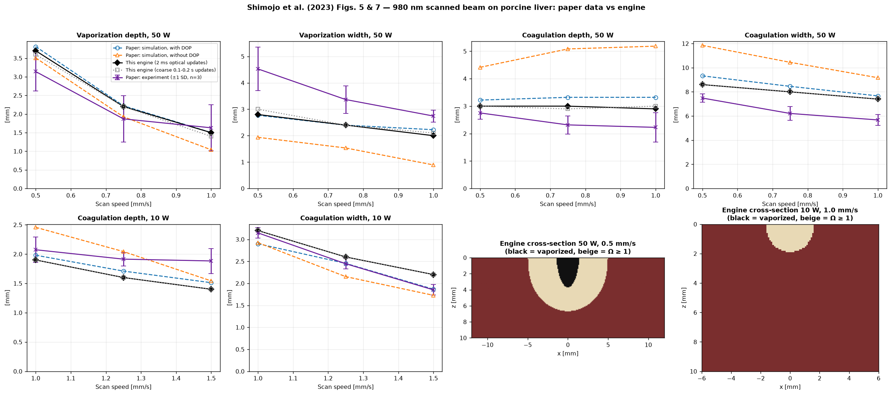

| Power / speed [mm/s] | Observable [mm] | Paper: experiment | Paper: sim (DOP) | Paper: sim (no DOP) | Engine, 2 ms | Engine, coarse | vs experiment | vs paper sim (DOP) |
|---|---|---|---|---|---|---|---|---|
| 50 W / 0.5 | Coagulation depth | 2.75 ± 0.23 | 3.22 | 4.42 | **3.00** | 3.00 | PASS (+9%) | **FAIL** (-7%) |
| 50 W / 0.5 | Coagulation width | 7.49 ± 0.36 | 9.32 | 11.85 | **8.60** | 8.60 | **FAIL** (+15%) | **FAIL** (-8%) |
| 50 W / 0.5 | Vaporization depth | 3.14 ± 0.52 | 3.81 | 3.51 | **3.70** | 3.60 | PASS (+18%) | PASS (-3%) |
| 50 W / 0.5 | Vaporization width | 4.53 ± 0.82 | 2.77 | 1.94 | **2.80** | 3.00 | PASS (-38%) | PASS (+1%) |
| 50 W / 0.75 | Coagulation depth | 2.32 ± 0.33 | 3.32 | 5.08 | **3.00** | 2.90 | PASS (+29%) | **FAIL** (-10%) |
| 50 W / 0.75 | Coagulation width | 6.21 ± 0.56 | 8.46 | 10.45 | **8.00** | 8.00 | **FAIL** (+29%) | **FAIL** (-5%) |
| 50 W / 0.75 | Vaporization depth | 1.87 ± 0.62 | 2.22 | 1.93 | **2.20** | 2.20 | PASS (+18%) | PASS (-1%) |
| 50 W / 0.75 | Vaporization width | 3.37 ± 0.52 | 2.40 | 1.53 | **2.40** | 2.40 | PASS (-29%) | PASS (+0%) |
| 50 W / 1.0 | Coagulation depth | 2.23 ± 0.53 | 3.32 | 5.19 | **2.90** | 3.00 | PASS (+30%) | **FAIL** (-13%) |
| 50 W / 1.0 | Coagulation width | 5.68 ± 0.46 | 7.67 | 9.17 | **7.40** | 7.40 | **FAIL** (+30%) | **FAIL** (-3%) |
| 50 W / 1.0 | Vaporization depth | 1.63 ± 0.62 | 1.50 | 1.04 | **1.50** | 1.40 | PASS (-8%) | PASS (-0%) |
| 50 W / 1.0 | Vaporization width | 2.74 ± 0.23 | 2.23 | 0.89 | **2.00** | 2.10 | **FAIL** (-27%) | **FAIL** (-10%) |
| 10 W / 1.0 | Coagulation depth | 2.07 ± 0.22 | 1.98 | 2.46 | **1.90** | 1.90 | PASS (-8%) | PASS (-4%) |
| 10 W / 1.0 | Coagulation width | 3.15 ± 0.12 | 2.90 | 2.92 | **3.20** | 3.20 | PASS (+2%) | **FAIL** (+10%) |
| 10 W / 1.25 | Coagulation depth | 1.91 ± 0.11 | 1.71 | 2.04 | **1.60** | 1.60 | PASS (-16%) | PASS (-6%) |
| 10 W / 1.25 | Coagulation width | 2.45 ± 0.12 | 2.45 | 2.15 | **2.60** | 2.60 | PASS (+6%) | PASS (+6%) |
| 10 W / 1.5 | Coagulation depth | 1.88 ± 0.21 | 1.51 | 1.54 | **1.40** | 1.40 | PASS (-26%) | PASS (-7%) |
| 10 W / 1.5 | Coagulation width | 1.85 ± 0.12 | 1.87 | 1.73 | **2.20** | 2.20 | **FAIL** (+19%) | **FAIL** (+18%) |

**Result.** Mean absolute deviation from the experiment is **20%** at 2 ms optical updates (**20%** with the earlier coarse 0.1–0.2 s updates), and **6%** from the authors' own simulation. Vaporization and coagulation *depths* are within 2 SD (+ 1 voxel) of the experiment in every case; at 50 W the engine under-predicts vaporization width and over-predicts coagulation width, the same direction as the paper's own simulation (the authors attribute this to carbonisation and temperature-independent thermal properties, neither modelled here).

## 2. Wang & Jacques (1992), MCML manual (and Wang, Jacques & Zheng 1995)
[MCML manual](https://omlc.org/software/mc/mcman.pdf) (free from OMLC), Chapter 6

**Paper data used.** Table 6.1 (slab, n = 1, μa = 10, μs = 90 cm⁻¹, g = 0.75, d = 0.02 cm; 10 × 50 000 photons): Rd and Tt from van de Hulst, MCML and Prahl, with standard errors. Table 6.2 (semi-infinite, n = 1.5, g = 0; 10 × 5 000 photons): Giovanelli, MCML and Prahl.

**Reproduction.** Identical optical properties, 10 batches × 200 000 photons; the Table 6.2 value is the *total* reflectance (diffuse + 0.04 specular) — confirmed with an independent 1-D Monte Carlo.

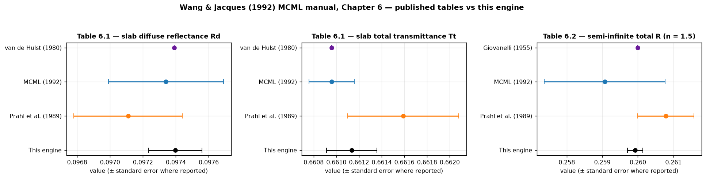

| Case | Quantity | Reference value | MCML | Prahl 1989 | This engine | Result |
|---|---|---|---|---|---|---|
| 6.1 slab, n = 1, μa = 10, μs = 90 /cm, g = 0.75, d = 0.02 cm | Rd | 0.09739 (vdH) | 0.09734 ± 0.00035 | 0.09711 ± 0.00033 | **0.09740 ± 0.00016** | PASS |
|  | Tt | 0.66096 (vdH) | 0.66096 ± 0.00020 | 0.66159 ± 0.00049 | **0.66113 ± 0.00022** | PASS |
| 6.2 semi-infinite, n = 1.5, μa = 10, μs = 90 /cm, g = 0 | R (total, incl. specular) | 0.2600 (Giovanelli) | 0.25907 ± 0.00170 | 0.26079 ± 0.00079 | **0.25992 ± 0.00021** | PASS |

**Result.** All three agree with every published column to within Monte Carlo error. This is the check that the Fresnel/TIR handling in the transport kernel is right.

## 3. McMillan et al. (2021), *Lasers Surg Med* 53(5):731–740
[doi:10.1002/lsm.23335](https://doi.org/10.1002/lsm.23335) — `references/McMillan2021_LSM_predictive_MCRT_fractional_CO2.pdf`

**Paper data used.** Fig. 3: OCT crater depth (mean, error bars) at 50–400 mJ/pixel and the authors' MCRT curves for ablation temperatures 300–500 °C (their best fit: 500 °C). Fig. 7: Ta = 500 °C for Gaussian, top-hat and triangular temporal profiles. Both digitised exactly from the vector figures (`code/digitize_mcmillan_fig3.py`).

**Reproduction.** Stated inputs: 250 µm top-hat beam; pulse length 1.2 ms per mJ (50 mJ → 60 ms) with triangular power; μa = 850 cm⁻¹, no scattering; tissue 75 % water + 25 % protein with the paper's ρ, cp, κ formulas; T0 = 5 °C; no surface cooling; water boiling at 100 °C (energy W·ρ·Lv = 1.86 J/mm³) with absorption and heat capacity falling as the water boils off; removal of the dehydrated voxel at Ta = 500 °C. **Not stated in the paper:** the absorption of the dehydrated tissue — baseline here 25 % of the wet value, with 100 % shown as sensitivity (0 % gives no ablation at all, because the dried column becomes transparent). Voxels 7.5 µm (paper: 3.75 × 3.75 × 7.5 µm).

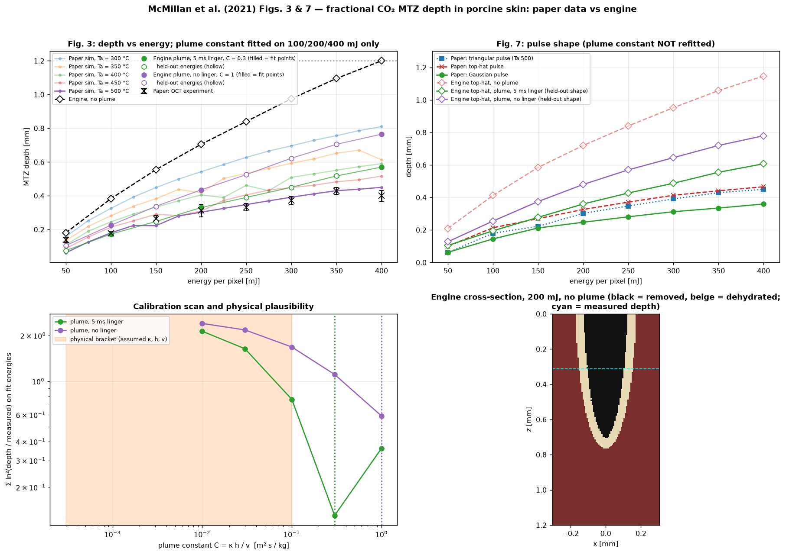

| Energy [mJ] | Paper: OCT experiment [µm] (error bar) | Paper: sim Ta = 500 °C | Engine, no plume | Engine + plume, 5 ms linger (C = 0.3) | Engine + plume, no linger (C = 1) |
|---|---|---|---|---|---|
| 50 | 140 (125–155) | 61 | 180 (PASS) | 75 (held-out: **FAIL**) | 105 (held-out: PASS) |
| 100 | 177 (165–188) | 180 | 382 (**FAIL**) | 172 (fit: PASS) | 225 (fit: **FAIL**) |
| 150 | 263 (245–281) | 222 | 555 (**FAIL**) | 248 (held-out: PASS) | 337 (held-out: **FAIL**) |
| 200 | 312 (276–349) | 302 | 705 (**FAIL**) | 330 (fit: PASS) | 435 (fit: **FAIL**) |
| 250 | 332 (310–354) | 348 | 840 (**FAIL**) | 390 (held-out: PASS) | 525 (held-out: **FAIL**) |
| 300 | 371 (346–396) | 391 | 975 (**FAIL**) | 450 (held-out: **FAIL**) | 622 (held-out: **FAIL**) |
| 350 | 429 (409–449) | 430 | 1095 (**FAIL**) | 518 (held-out: **FAIL**) | 705 (held-out: **FAIL**) |
| 400 | 399 (368–430) | 450 | 1200 (**FAIL**) | 570 (fit: **FAIL**) | 765 (fit: **FAIL**) |

Held-out pulse shape (Fig. 7 top-hat, constant not refitted):

| Energy [mJ] | Paper: sim, top-hat pulse (Fig. 7) [µm] | Engine, no plume | Engine + plume, 5 ms linger | Engine + plume, no linger |
|---|---|---|---|---|
| 50 | 100 | 210 | 105 (PASS) | 128 (PASS) |
| 100 | 214 | 412 | 195 (PASS) | 255 (**FAIL**) |
| 150 | 270 | 585 | 277 (PASS) | 375 (**FAIL**) |
| 200 | 326 | 720 | 360 (**FAIL**) | 480 (**FAIL**) |
| 250 | 371 | 840 | 428 (**FAIL**) | 570 (**FAIL**) |
| 300 | 414 | 952 | 488 (**FAIL**) | 645 (**FAIL**) |
| 350 | 441 | 1057 | 555 (**FAIL**) | 720 (**FAIL**) |
| 400 | 466 | 1148 | 607 (**FAIL**) | 780 (**FAIL**) |

**Result — does not reproduce without a plume.** With the paper's stated inputs the engine ablates **2.1–2.6× deeper** than the OCT experiment at 150–300 mJ and reaches the bottom of the 1.2 mm domain at 400 mJ. Converting the engine's crater volume to energy (2.89 J/mm³ to boil a voxel and heat it to Ta) shows it removes 33 / 29 / 27 % of the pulse at 100 / 200 / 300 mJ, versus 25 / 22 / 18 % for a full-width 250 µm cylinder at the measured depth.

**Plume-shielding closure: a calibration, not a validation.** Ablated mass leaves as a plume that absorbs and scatters the beam. The closure is τ = C·ṁ″, delivered power × exp(−τ), where ṁ″ [kg/m²/s] is the ablated mass flux and **C = κ_eff·h / v_exit [m²·s/kg]** (mass extinction × plume height ÷ exit speed). It has one free parameter. To keep the test honest it was fitted on the experiment at 100, 200 and 400 mJ only (log-ratio least squares over a grid), then applied unchanged to the five other energies and to Fig. 7's top-hat pulse, a different pulse shape:

- fitted C = **0.3** (5 ms plume linger) or **1** (no linger); the linger term re-counts residence time already contained in h/v_exit, so both are shown;
- held-out Fig. 3 energies within error bars: **2/5** (5 ms linger), **1/5** (no linger);
- Fig. 7 top-hat pulse (paper's simulation, within 0.03 mm): **3/8** (5 ms linger), **1/8** (no linger).

**Plausibility.** With assumed (not measured) ranges κ_eff 100–1000 m²/kg, h 0.3–1 mm, v_exit 10–100 m/s, C should lie between 3×10⁻⁴ and 0.1 m²·s/kg. The fitted values are 3× and 10× above the upper end (the no-linger optimum sits at the edge of the scanned grid, so it is a lower bound). So the data can be matched only with a plume far more opaque, or far slower, than this estimate, which means plume shielding is **not established** as the mechanism: the constant is probably absorbing other missing physics (carbonization, beam geometry, or whatever else the authors' model contains). A measured plume extinction or exit speed would turn this into a real test.

## 4. Kim et al. (2023), *J Comput Des Eng* 10(3):947–958
[doi:10.1093/jcde/qwad033](https://doi.org/10.1093/jcde/qwad033) — `references/Kim2023_JCDE_laser_tissue_skin_lesions_fulltext.html` (Internet Archive snapshot)

**Paper data used.** Sections 4.2–4.3: for four ex vivo skin specimens, the simulated and measured mean coagulation depth and top-view area (PS1, PS2; 55 °C criterion) and mean ablation depth and top-view area (PS3, PS4; 200 °C criterion). No error bars are reported.

**Reproduction.** 1060 nm pulse train treated as continuous 15 W (1 MHz, 120/480 ns pulses); source = 1.2 mm disk with e^(−2r/R) weighting as in the paper's Monte Carlo; μa = 0.7512 cm⁻¹, μs = 70 cm⁻¹, g = 0.9, n = 1.4; ρ_l c_l = 1109 × 3391, κ0 = 0.37 W/(m·K), post-vaporisation ρ_g c_g = 4400 × 382, water fraction 0.75, h_fg = 2.17×10⁹ J/m³, T0 = 25 °C. Like the paper, tissue is never removed and the lesion is the region that reached 55 °C / 200 °C. **Not reported in the paper: irradiation time.** It is the single fitted parameter, one per group, chosen so the engine's mean depth equals the mean of the two measured depths (coagulation group: 69 ms; ablation group: 769 ms). The depth *difference* between specimens and the top-view *area* are then predictions. Flat slab instead of the OCT-measured surface.

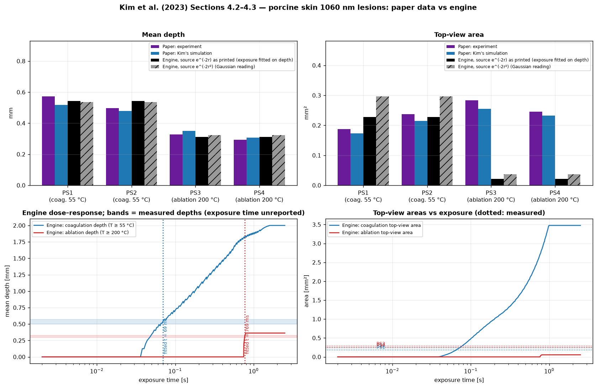

| Specimen | Criterion | Exposure | Depth: exp [mm] | Depth: Kim sim | Depth: engine | Depth | Area: exp [mm²] | Area: Kim sim | Area: engine | Area | Area: engine, Gaussian reading |
|---|---|---|---|---|---|---|---|---|---|---|---|
| PS1 | coagulation 55 °C | 69 ms (fitted) | 0.572 | 0.518 | **0.543** | PASS | 0.187 | 0.173 | **0.228** | PASS | 0.296 |
| PS2 | coagulation 55 °C | 69 ms (fitted) | 0.498 | 0.478 | **0.543** | PASS | 0.237 | 0.215 | **0.228** | PASS | 0.296 |
| PS3 | ablation 200 °C | 769 ms (fitted) | 0.327 | 0.351 | **0.313** | PASS | 0.283 | 0.255 | **0.021** | **FAIL** | 0.037 |
| PS4 | ablation 200 °C | 769 ms (fitted) | 0.293 | 0.308 | **0.313** | PASS | 0.246 | 0.232 | **0.021** | **FAIL** | 0.037 |

**Sensitivity of the fitted-exposure comparison.** Because exposure time is fitted, small changes move the areas a lot: for the coagulation group a ±10 % change in exposure changes the predicted top-view area from 0.164 to 0.282 mm² (central 0.223) while the depth moves from 0.487 to 0.572 mm. For the ablation group the engine's 200 °C depth is a step: it is 0.000 mm just before and 0.362 mm just after the fitted time, because all sub-surface voxels finish vaporising within a few ms of each other — so that fitted exposure is poorly determined.

**Result — mixed.** Coagulation group: with exposure fitted on depth alone, the predicted top-view area (0.228 mm²) lies between the two measured areas (0.187 and 0.237 mm²) — an unfitted agreement, but a fragile one: it holds for the source formula as printed, e^(−2r), while the Gaussian reading e^(−2r²) gives 0.296 mm² (measured 0.187 / 0.237). Ablation group: depth is matched by construction, but the engine's 200 °C region at the *surface* is only 0.021 mm² (Gaussian reading: 0.037) against 0.246–0.283 mm² measured. The on-axis deposition is nearly flat with depth (maximum 1.00× the surface value, at 0.01 mm; a few-percent Monte Carlo noise), so neither the source-formula reading nor a sub-surface deposition peak explains the miss; the cause was not identified. The depth rows cannot fail meaningfully because exposure is fitted — they are listed as *calibrated*, not validated.

## 5. Keller et al. (2016), *Sci Rep* 6:20936
[doi:10.1038/srep20936](https://doi.org/10.1038/srep20936) — `references/Keller2016_SciRep_laser_mortality_Anopheles.pdf`

**Paper data used.** Table 1 (reproduced below, verified against the PDF): LD90 fluence of *Anopheles stephensi* mosquitoes for ten wavelength / beam / pulse-length combinations.

**What can and cannot be reproduced.** Mortality of a mosquito is not something this engine models — the paper gives no mosquito optical or thermal properties and the endpoint is biological — so Table 1 itself is **not** reproduced. The paper does make a physical claim the engine can test: lethal fluence is set by thermal damage and depends on pulse length through thermal confinement. For the three 10.6 µm rows (absorber = water, μa ≈ 850 cm⁻¹, known independently of the mosquito) the engine computes the fluence at which an Arrhenius damage integral reaches Ω = 1 at the surface of a water-like body (1-D explicit bioheat, 25 °C start, including cooling), for two published kinetics. Nothing is tuned.

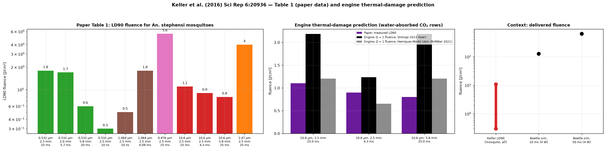

| λ [nm] | Beam Ø [mm] | Pulse | Power range [W] | LD90 fluence [J/cm²] | LD90 pulse energy [mJ] | LD90 power [W] |
|---|---|---|---|---|---|---|
| 532 | 2.3 | 25 ms | — | 1.8 | 74 | 3 |
| 532 | 2.0 | 5.7 ms | — | 1.7 | 48 | 8.5 |
| 532 | 5.8 | 20 ms | — | 0.6 | 170 | 8.5 |
| 532 | 2.5 | 10 ns | — | 0.3 | 10 | 1e+06 |
| 1064 | 2.5 | 10 ns | — | 0.5 | 26 | 2.6e+06 |
| 1064 | 2.5 | 0.09 ms | — | 1.8 | 90 | 1000 |
| 976 | 2.5 | 25 ms | — | 5.6 | 273 | 10.9 |
| 10600 | 2.5 | 25 ms | — | 1.1 | 52 | 2.1 |
| 10600 | 2.5 | 4.3 ms | — | 0.9 | 44 | 10.2 |
| 10600 | 5.8 | 25 ms | — | 0.8 | 211 | 8.4 |
| 1470 | 2.5 | 25 ms | — | 4.0 | 197 | 7.9 |

Engine prediction for the water-absorbed rows:

| Arrhenius kinetics | Condition (10.6 µm) | Paper LD90 [J/cm²] | Engine Ω = 1 fluence | Engine / paper | Within factor 1.5 |
|---|---|---|---|---|---|
| Henriques-Moritz (skin; McMillan 2021) | 2.5 mm / 25.0 ms | 1.10 | **1.20** | 1.09× | PASS |
| Henriques-Moritz (skin; McMillan 2021) | 2.5 mm / 4.3 ms | 0.90 | **0.65** | 0.73× | PASS |
| Henriques-Moritz (skin; McMillan 2021) | 5.8 mm / 25.0 ms | 0.80 | **1.20** | 1.50× | **FAIL** |
| Shimojo 2023 (liver) | 2.5 mm / 25.0 ms | 1.10 | **2.18** | 1.99× | **FAIL** |
| Shimojo 2023 (liver) | 2.5 mm / 4.3 ms | 0.90 | **1.23** | 1.37× | PASS |
| Shimojo 2023 (liver) | 5.8 mm / 25.0 ms | 0.80 | **2.18** | 2.73× | **FAIL** |

**Result.** Predicted / measured fluence for the six rows ranges from 0.73× to 2.73× (Henriques–Moritz kinetics: 1.09, 0.73, 1.50; Shimojo-liver kinetics: 1.99, 1.37, 2.73), so the thermal-damage picture gets the *magnitude* of the 10.6 µm lethal fluence to within a factor of 2.7. It over-predicts the pulse-length dependence: the 25 ms / 4.3 ms fluence ratio is 1.84 (Henriques–Moritz) or 1.77 (Shimojo) against 1.22 measured, i.e. the measured lethal fluence is much less sensitive to pulse length than a semi-infinite water body predicts. The 1-D model also cannot reproduce the beam-size effect (2.5 mm vs 5.8 mm at 25 ms: 1.1 vs 0.8 J/cm² measured, identical in 1-D), and mosquito mortality is not a skin-burn endpoint — so this is an order-of-magnitude consistency check, not a validation. **For the beetle study:** the 127–637 J/cm² delivered in the beetle simulations is 12–2 100× Keller's lethal fluences (0.3–10.9 J/cm², mosquito); the previously quoted '300–800 J/cm² beetle puncture threshold' does not appear in this paper, and no beetle-cuticle dataset was found.

## 6. Sagi-Dolev et al. (1992), *Opt Eng* 31(7):1425–1431
[doi:10.1117/12.58733](https://doi.org/10.1117/12.58733) — paywalled; not in `references/`

**Paper data used.** Only the abstract could be verified: the model removes tissue in the stages listed below and was compared with temperature fields measured in tissue exposed to pulses of highly absorbed radiation (“good agreement”). **No numerical data from the paper were accessible, so no numerical comparison is made.** If you can supply the PDF, a data comparison can be added.

**Reproduction.** The engine's two-stage mode implements the same sequence. The figure shows it on an illustrative case that is *not* from the paper (0.5 W/mm² at 10.6 µm on McMillan's tissue model, Ta = 300 °C).

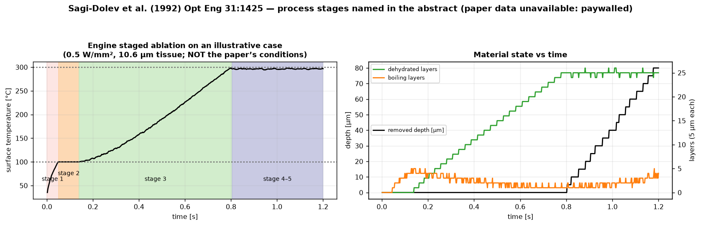

| # | Stage named in the paper’s abstract | Engine implementation | Status |
|---|---|---|---|
| 1 | Heating to the boiling temperature of water | explicit bioheat solver, T rises to T_abl = 100 C | implemented |
| 2 | Boiling and evaporation of the water content | latent-heat plateau: superheat banked as enthalpy, T held at 100 C | implemented |
| 3 | Heating of the dehydrated tissue to its ablation temperature | dry-state voxel (dry rho c, k, mu_a) heats freely to t_remove | implemented |
| 4 | Removal of the relevant material | voxel converted to void (air) when T >= t_remove | implemented |
| 5 | Adapting the new geometrical boundaries | optical field recomputed in the new geometry every epoch (MC) and thermal contact to air updated | implemented |

**Result.** Stage order is correct: boiling starts at 50 ms (the analytic semi-infinite estimate is ≈ 58 ms), the first dehydrated layer appears at 140 ms and the first removal at 804 ms. This shows structural consistency with the paper's description only; it does not validate the temperatures or speeds.

## 7. van de Hulst (1980), *Multiple Light Scattering*, Vol. II
Not redistributable. Values taken from MCML manual Table 6.1 ([MCML manual](https://omlc.org/software/mc/mcman.pdf) (free from OMLC)).

**Paper data used.** Slab Rd = 0.09739 and Tt = 0.66096 (optical thickness 2, albedo 0.9, g = 0.75, n = 1). Only these two numbers are available from the sources on hand; the book's other tables are not.

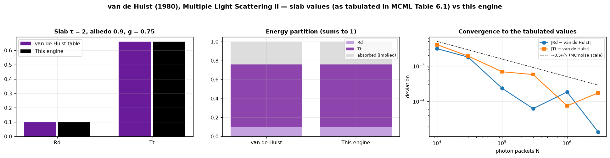

| Quantity | van de Hulst | This engine (10 × 200 000 photons) | Difference | Rel. err. | Result |
|---|---|---|---|---|---|
| Rd | 0.09739 | 0.09740 ± 0.00016 | +0.00001 | 0.01% | PASS |
| Tt | 0.66096 | 0.66113 ± 0.00022 | +0.00017 | 0.03% | PASS |

Convergence (single runs):

| N photons | Rd − 0.09739 | Tt − 0.66096 |
|---|---|---|
| 10,000 | -0.00311 | +0.00403 |
| 30,000 | -0.00179 | +0.00192 |
| 100,000 | +0.00024 | -0.00069 |
| 300,000 | -0.00006 | -0.00058 |
| 1,000,000 | +0.00018 | -0.00007 |
| 3,000,000 | +0.00001 | +0.00017 |

**Result.** Rd and Tt agree to within Monte Carlo error; at 3×10⁶ photons the deviations are ≤ 2×10⁻⁴, the size of the noise (≈ 0.5/√N), so no systematic offset is resolved at that level.

## 8. Giovanelli (1955), *Optica Acta* 2:153
Not redistributable. Value taken from MCML manual Table 6.2.

**Paper data used.** Semi-infinite medium, n = 1.5, albedo 0.9, g = 0: R = 0.2600. (Giovanelli's other albedos are not available from the sources on hand, so the sweep is checked against an independent code instead.)

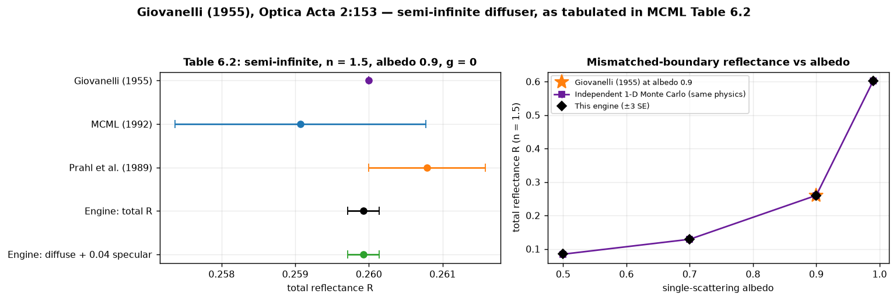

| Case | Reference | This engine | Rel. err. | Result |
|---|---|---|---|---|
| Giovanelli table (albedo 0.9) | 0.2600 | 0.25992 ± 0.00021 | 0.03% | PASS |
| Independent 1-D MC, albedo 0.5 | 0.08423 | 0.08460 ± 0.00019 | 0.43% | PASS |
| Independent 1-D MC, albedo 0.7 | 0.12883 | 0.12914 ± 0.00026 | 0.24% | PASS |
| Independent 1-D MC, albedo 0.9 | 0.25991 | 0.25964 ± 0.00075 | 0.10% | PASS |
| Independent 1-D MC, albedo 0.99 | 0.60209 | 0.60184 ± 0.00019 | 0.04% | PASS |

**Result.** Agreement within error, provided the Table 6.2 value is read as *total* reflectance (specular included) — the diffuse-only value is 0.2198.

## 9. Prahl, Keijzer, Jacques & Welch (1989), *SPIE IS* 5:102
Not redistributable. Values taken from MCML manual Tables 6.1/6.2.

**Paper data used.** Their Monte Carlo results with standard errors: Rd 0.09711 ± 0.00033, Tt 0.66159 ± 0.00049 (slab); R 0.26079 ± 0.00079 (semi-infinite, n = 1.5).

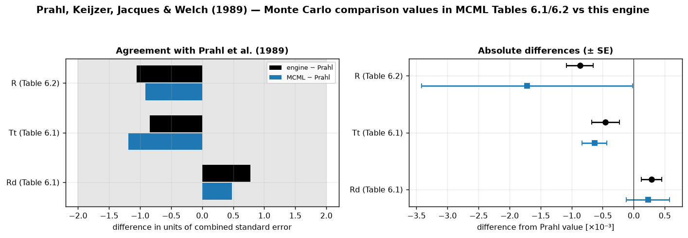

| Quantity | Prahl 1989 | MCML | This engine | Engine − Prahl | Verdict |
|---|---|---|---|---|---|
| Rd (Table 6.1) | 0.09711 ± 0.00033 | 0.09734 ± 0.00035 | 0.09740 ± 0.00016 | +0.78 σ | within 2σ |
| Tt (Table 6.1) | 0.66159 ± 0.00049 | 0.66096 ± 0.00020 | 0.66113 ± 0.00022 | -0.85 σ | within 2σ |
| R (Table 6.2) | 0.26079 ± 0.00079 | 0.25907 ± 0.00170 | 0.25992 ± 0.00021 | -1.06 σ | within 2σ |

**Result.** The engine is within 2σ (combined standard error) of Prahl's values in all three cases, as is MCML.

## 10. Chandrasekhar (1960), *Radiative Transfer* (Dover), Ch. V
Not redistributable.

**Paper data used.** The exact diffuse reflectance of an index-matched semi-infinite isotropic scatterer, Rd = 1 − H(1)√(1 − ω), computed here from the H-function integral equation (Gauss–Legendre, 400 nodes; identity ∫H dμ = (2/ω)(1 − √(1 − ω)) satisfied to 10⁻¹⁵). The book's tabulated H values are not on hand, so the exact solution is recomputed rather than transcribed.

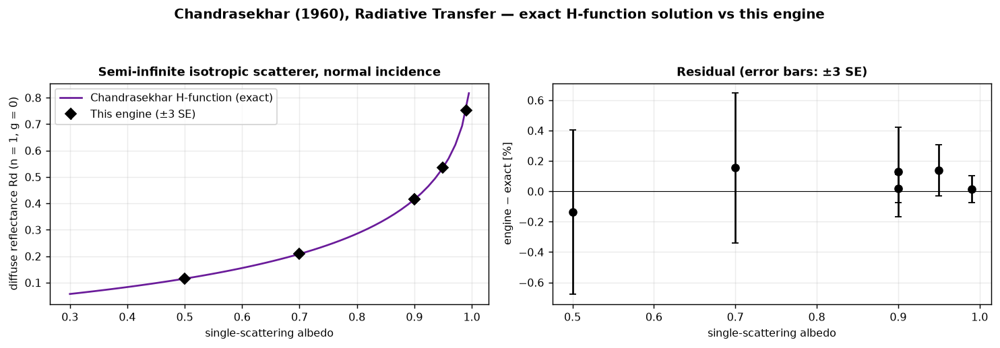

| Albedo | Exact Rd | This engine | Rel. err. | Result |
|---|---|---|---|---|
| 0.5 | 0.11523 | 0.11507 ± 0.00021 | 0.13% | PASS |
| 0.7 | 0.20868 | 0.20900 ± 0.00034 | 0.15% | PASS |
| 0.9 | 0.41495 | 0.41548 ± 0.00041 | 0.13% | PASS |
| 0.9 | 0.41495 | 0.41502 ± 0.00013 | 0.02% | PASS |
| 0.95 | 0.53554 | 0.53627 ± 0.00030 | 0.14% | PASS |
| 0.99 | 0.75272 | 0.75284 ± 0.00022 | 0.02% | PASS |

**Result.** Agreement within Monte Carlo error across albedo 0.5–0.99.

## 11. Carslaw & Jaeger (1959), *Conduction of Heat in Solids*
Not redistributable.

**Paper data used.** The classical image-source solution for an insulated half-space heated by an exponentially decaying volumetric source Q = I μ e^(−μz), implemented in `verification_benchmarks.beer_lambert_profile` (checked against the independent surface formula to 6 digits).

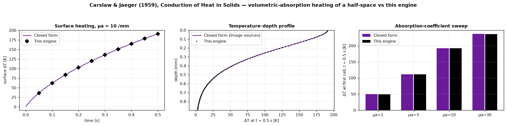

| ID | Case | Closed form | Engine | Rel. err. | Result |
|---|---|---|---|---|---|
| V3a | Beer-Lambert surface heating, t = 0.5 s | 191 | 190.9 | 0.09% | PASS |
| V3b | Thermal energy conservation (insulated) | 0.009874 | 0.009874 | 0.00% | PASS |
| V3c-mu1 | Cell-centre heating, mu_a = 1 /mm, t = 0.5 s | 49.65 | 49.15 | 1.01% | PASS |
| V3c-mu3 | Cell-centre heating, mu_a = 3 /mm, t = 0.5 s | 111.1 | 111 | 0.10% | PASS |
| V3c-mu10 | Cell-centre heating, mu_a = 10 /mm, t = 0.5 s | 192.4 | 192 | 0.18% | PASS |
| V3c-mu30 | Cell-centre heating, mu_a = 30 /mm, t = 0.5 s | 236.7 | 235.8 | 0.36% | PASS |

**Result.** The explicit finite-volume solver coupled to the Monte Carlo deposition reproduces the surface history, the full depth profile and the μa dependence, and conserves energy to round-off.

## 12. Internal-consistency checks (no literature data)
`code/consistency_checks.py`. These compare the engine with **exact or independent calculations derived from the stated inputs**; no paper is involved, so they verify the code, they do not validate beetle physics.

- **C1 layered conduction.** Heat conducted through a 0.25 mm solid-chitin stack and through a sandwich with an *assumed* air-filled core (k_eff = 0.08 W/(m·K)), engine vs an independent BDF ODE solve of the same finite-volume system. The engine's solid/sandwich heat ratio (3.45) is close to the steady series-resistance ratio (3.40); that is a consequence of the assumed conductivity, not evidence about any beetle.
- **C2 radiant heating.** A 1 mm body heated at its top face and cooled through its top and bottom faces (lateral faces adiabatic), against the lumped-capacitance solution with that geometry, run for ≈ 6 time constants.
- **C3 oblique incidence.** Specular reflectance against exact unpolarised Fresnel, and the mean absorption depth against the exact value cos θt/μa of the refracted ray, for θ = 0–60° on n = 1.55. Dynamic ablation at oblique incidence is implemented but has no benchmark.
- **C4 char kinetics.** The first-order pyrolysis kernel against the closed form and a high-accuracy ramp integration. The kinetics (A = 10¹⁰ s⁻¹, Ea = 1.2×10⁵ J/mol) are test values, **not measured for chitin**; carbonization has no data-backed benchmark yet (it needs a thermogravimetric run on the cuticle).

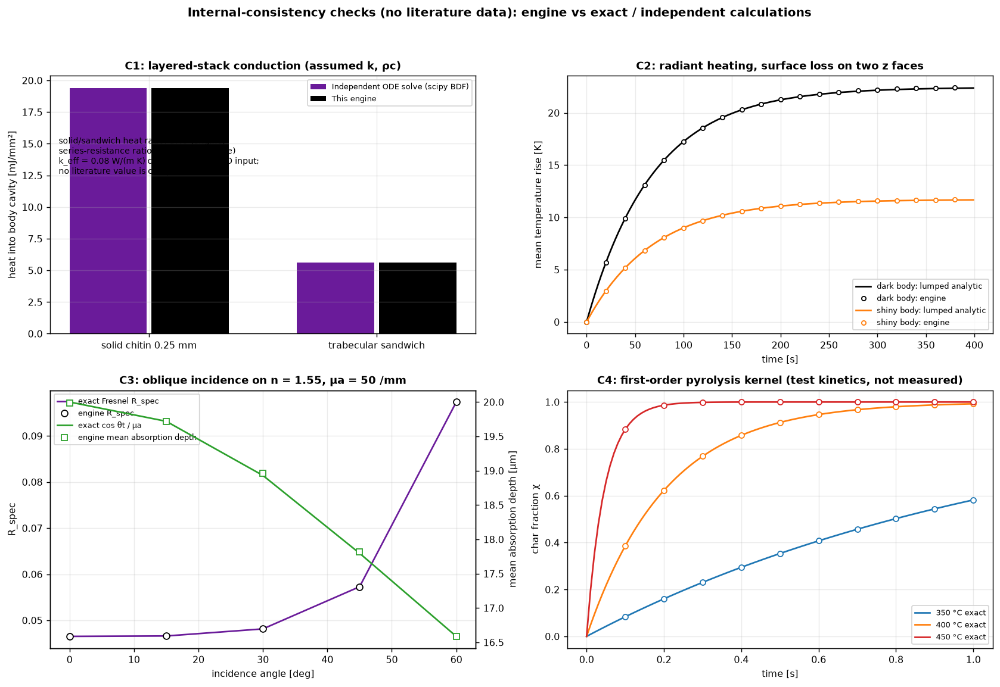

| ID | Check | Reference (derived, not typed) | Reference value | Engine | Rel. err. | Result |
|---|---|---|---|---|---|---|
| C1-solid | Layered cuticle stack, cumulative ventral heat (solid) | Independent ODE solve (scipy BDF) of the same finite-volume system | 19.388 | 19.388 | 0.00% | PASS |
| C1-sandwich | Layered cuticle stack, cumulative ventral heat (sandwich) | Independent ODE solve (scipy BDF) of the same finite-volume system | 5.6213 | 5.6213 | 0.00% | PASS |
| C2-dark-tau | Radiant heating at t = tau (dark body) | Lumped-capacitance solution with the engine's boundary geometry | 14.149 | 14.109 | 0.28% | PASS |
| C2-dark-end | Radiant heating at t = 400 s (dark body) | Lumped-capacitance solution with the engine's boundary geometry | 22.374 | 22.436 | 0.28% | PASS |
| C2-shiny-tau | Radiant heating at t = tau (shiny body) | Lumped-capacitance solution with the engine's boundary geometry | 7.3819 | 7.3612 | 0.28% | PASS |
| C2-shiny-end | Radiant heating at t = 400 s (shiny body) | Lumped-capacitance solution with the engine's boundary geometry | 11.673 | 11.706 | 0.28% | PASS |
| C3-R-0 | Specular reflectance at 0 deg (n = 1.55) | Exact unpolarised Fresnel | 0.046521 | 0.046521 | 0.00% | PASS |
| C3-z-0 | Mean absorption depth at 0 deg | Exact: cos(theta_t) / mu_a along the refracted ray | 0.02 | 0.019981 | 0.10% | PASS |
| C3-R-15 | Specular reflectance at 15 deg (n = 1.55) | Exact unpolarised Fresnel | 0.046607 | 0.046607 | 0.00% | PASS |
| C3-z-15 | Mean absorption depth at 15 deg | Exact: cos(theta_t) / mu_a along the refracted ray | 0.019719 | 0.01972 | 0.01% | PASS |
| C3-R-30 | Specular reflectance at 30 deg (n = 1.55) | Exact unpolarised Fresnel | 0.04814 | 0.04814 | 0.00% | PASS |
| C3-z-30 | Mean absorption depth at 30 deg | Exact: cos(theta_t) / mu_a along the refracted ray | 0.018931 | 0.018965 | 0.18% | PASS |
| C3-R-45 | Specular reflectance at 45 deg (n = 1.55) | Exact unpolarised Fresnel | 0.057288 | 0.057288 | 0.00% | PASS |
| C3-z-45 | Mean absorption depth at 45 deg | Exact: cos(theta_t) / mu_a along the refracted ray | 0.017798 | 0.017816 | 0.10% | PASS |
| C3-R-60 | Specular reflectance at 60 deg (n = 1.55) | Exact unpolarised Fresnel | 0.097344 | 0.097344 | 0.00% | PASS |
| C3-z-60 | Mean absorption depth at 60 deg | Exact: cos(theta_t) / mu_a along the refracted ray | 0.016587 | 0.016591 | 0.02% | PASS |
| C4-iso | Char fraction after 0.5 s at 400 C (isothermal) | Closed form 1 - exp(-k t) | 0.91263 | 0.91263 | 0.00% | PASS |
| C4-ramp | Char fraction after a 300 -> 500 C ramp | High-accuracy ODE integration | 1 | 1 | 0.00% | PASS |

**Result, and a bug found by C2.** The first run of C2 failed by exactly a factor of two: the engine's steady-state rise was half the physical value. The cause was the convective boundary term in `voxel_thermal_3d.py`, `h/(0.5·dz)` per unit volume where `h/dz` is correct (a cell of thickness dz presents area/volume = 1/dz), so every surface loss was **2× too strong**. It now uses the half-cell conduction resistance in series with h. All literature comparisons in this report use adiabatic boundaries (h = 0), so none of them change; scripts that apply surface cooling (e.g. `simulation/run_dynamic_ablation_3d.py`) now lose less heat than before and should be re-run before their numbers are quoted.

---

## Effect of the 2 ms optical update

The optical field is recomputed after each interval; energy deposited into voxels that have already finished vaporising is lost until the next refresh.

| Test | Optical update | Result | Within tolerance |
|---|---|---|---|
| Ablation-front speed (energy-balance test V4) | 10 ms | 177.6 µm/s (6.8% from exact) | **FAIL** |
|  | 2 ms | 186.8 µm/s (1.9% from exact) | PASS |
| Shimojo replication: mean |error| vs experiment | 0.1–0.2 s (coarse) | 20% |  |
|  | 2 ms | 20% |  |

## What this does and does not support for the beetle study

### Supported by the evidence here
- **Photon transport and heat-conduction numerics** (references 2, 7–11 and the internal checks): exact agreement with H-function, MCML tables, Fresnel/Snell optics and closed-form conduction solutions to Monte Carlo precision.
- **Continuous-wave soft-tissue ablation and coagulation** (reference 1): scanned-beam depths within the experimental scatter at 10 W and 50 W; widths less well.

### Not supported
- **Pulsed CO₂ crater depth** (reference 3): the engine over-predicts 2–3×; a one-parameter plume closure can be fitted, but only at a value well above the assumed physical range, so the mechanism is unproven.
- **Anything beetle-specific.** No data-backed benchmark involves insect cuticle. The cuticle trabecular insulation and whole-beetle heating checks are internal consistency tests of assumed inputs, not literature validation.
- **Carbonization:** only the kinetics kernel is verified; parameters are unmeasured and no benchmark exercises it.
- **Surface-patch ablation size in Kim's skin model** (reference 4), and mosquito mortality (reference 5).

### Needed to move forward
- Cuticle optical properties (integrating sphere) and thermogravimetric kinetics for carbonization.
- Dosed-beetle mortality and crater data at several fluences and pulse lengths; hold some out for blind prediction.
- A measured plume extinction or ablation exit speed, so the plume constant is constrained independently of the data it is meant to explain.
- Verified citations for any further beetle thermal or optical studies, with the source file added to `references/` before a comparison is made.

## Layout

```
README.md                         this document (generated by code/build_report.py)
images/                           one comparison figure per reference (ref01–ref12) + benchmark_scorecard.png
code/
  run_literature_benchmarks.py    master runner → raw_output/benchmark_results.json, scorecard figure
  verification_benchmarks.py      exact / canonical checks (MCML tables, Fresnel, H-function, Carslaw & Jaeger, energy balance)
  consistency_checks.py           internal-consistency checks (no literature data)
  validation_benchmarks.py        Shimojo 2023 scanned-beam replication (parallel, cached)
  mcmillan_benchmark.py           McMillan 2021 single-pixel CO2 ablation (no-plume baseline)
  plume_calibration.py            plume-constant calibration with held-out testing
  kim_benchmark.py                Kim 2023 skin lesions (exposure fitted, labelled)
  keller_benchmark.py             Keller 2016 thermal-damage fluence check (mortality not modelled)
  sagi_stages.py                  Sagi-Dolev 1992 stage-by-stage illustration (paper data unavailable)
  digitize_shimojo_figures.py     Shimojo Figs. 5, 7 → raw_output/shimojo2023_digitized.json
  digitize_mcmillan_fig3.py       McMillan Figs. 3, 7 (exact, from the vector drawing)
  build_report.py, report_text.py figure + README generation
  bench_common.py                 result record and paths
raw_output/                       results JSON, digitised paper data, caches, console logs
references/                       source papers / snapshots; references/README.md has the citations
```

## Reproduce

```bash
./venv/bin/python knowledge/simulation_lit_comparison/code/run_literature_benchmarks.py --rerun-validation   # all simulations (hours; omit the flag to reuse caches, ~1 min)
./venv/bin/python knowledge/simulation_lit_comparison/code/build_report.py                                   # figures + this README
pip install pymupdf   # only needed to re-run the digitisers
```
